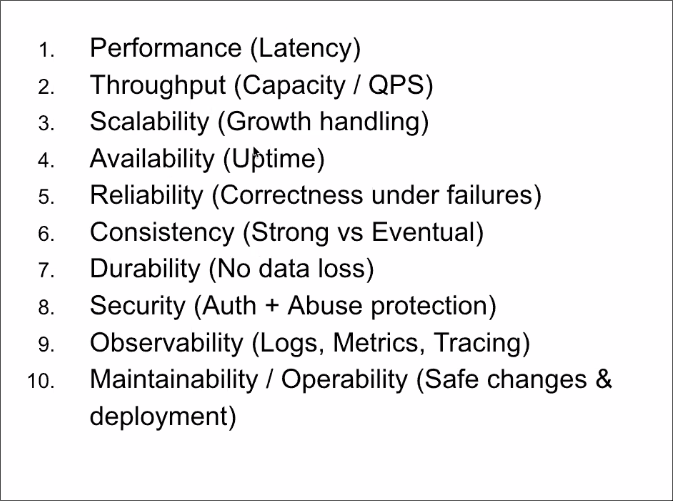

This is the cohort to make you interview ready for system design
Todays assignment : vibe code the counter website 
Understand these: 
1. cloud platform :  AWS 
2. debugging and logging
3. Deployement and hosting
4. 

THis is not what gives you edge, what gives you edge? 
You just cannot watch videos and expect you to be good at system design

Junior engineer : can think of happy paths 
senior engineer: can think of potential issues 
1. What if too many users use it ?
2. what if server crashes 
3. 
Think always of bottleneck -> where your system can choke ?

A seniot engineer asks right questions: 
If 1M

Before we solve framing `requirements` is critical .
p95 < 200 ms for 5k QPS 
etc 

Requirements :
a. Functional : 
b. Non functional : framework to solve this ->  there is no ambiguity 

Rule of HLD:  the more fancy you become you are in more trouble 

Latency 
Scalablity 
Throughput 
Reliablity 

Rule :  if you need 20% to answer 95% of questions 
There is also so many foundational stuff that matter here 
How many connections can a EC2 handle 
How many connections does database handle 

Having knowledge is just not enough -> if you want to read of anyhting its one percent away 
Its important to make mindset that% of things 
HW: 
vibecode and read about these terms 

We will have a lecture to talk about numbers also 

What does TLS handshake work, how does https work? 

VCPU vs COre? hyperthreading ? 
t3 -> hyperthreafinf 
t4 ->  no hyperthreading 
One vcpu can have one core 
To execute a line we need one core 
to have one server and increse vcpus => vertical sclaing
1 VCPU => 1 instructions

Being stateful and stateless 
Server are stateless, you can have multiple servers , but having multiple database is difficult 

Load balancer =>  multiple server 

DNS  -> your internet itslef is a load balancer 
Easiest way to mess up your system desing round is throwing so many terms 

Scalablity : scale improvements without bottle

Health-check = > arre you up ? 
3 health checks pass => assume that the server is up
if failed multiple times =>load balancer will stop sending stuff 

Reliablity : if something comes , is it true ? 
Indempotency : send with particular key 

Consistency :  -> eventual consistency 
always consistent 

Queues => durable queues 
RabbitMQ, Kafka, ActiveMQ 

API Gateway : 
Client ->API gateway Auth + rate limit 
does authorisation, rate limiting , routing 

Most cases we only need => Clients -> API gateway ->Load baalncer ->API server 1,2,3 -> Queue -> Workers (1,2,3,4) -> update cache 
                                                                                                            -> update database 

The goal is to learn about interview framework => these are peices and we need to deliver in a interview in a structured way 
HW -> 
Vibecode and deploy on cloud 